<div align="center">

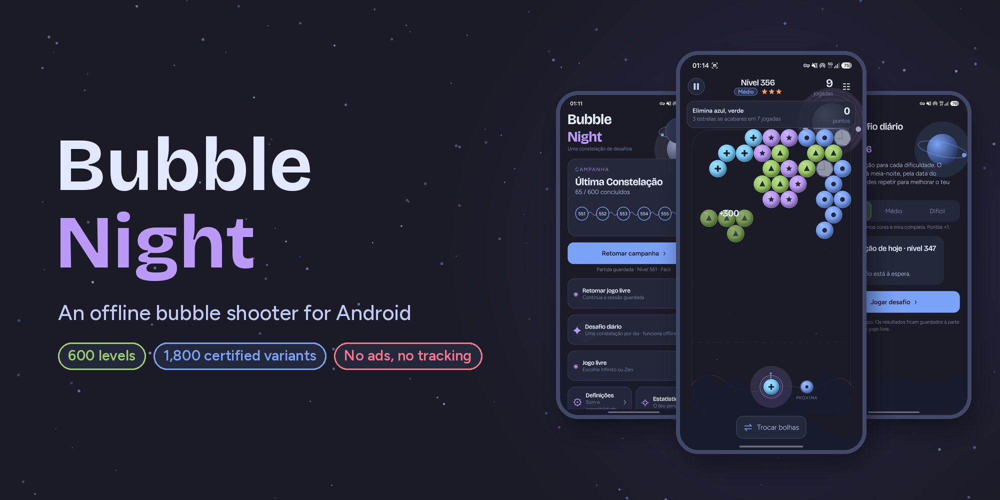

# Bubble Night

**An offline bubble shooter for Android: 600 constellations in three difficulties, every one proven solvable.**

[](https://github.com/SyscallBrain/bubble-night/actions/workflows/ci.yml)
[](https://github.com/SyscallBrain/bubble-night/releases/latest)
[](LICENSE)


<br>


[Download](#download) · [Features](#features) · [Screenshots](#screenshots) · [How to play](#how-to-play) · [Build](#building-from-source) · [Architecture](#architecture) · [Contributing](#contributing)

</div>

---

## About

Bubble Night is a calm, night-sky take on the classic bubble shooter. You aim, bounce off the walls and connect three or more bubbles of the same color, travelling through **twelve orbits of fifty constellations**. Each constellation comes in Easy, Medium and Hard.

Every level ships with a **solution certificate**. An offline solver plays each of the 1,800 variants with the same Kotlin engine that runs the game, and the build replays those certificates. If a level stops being solvable within its three-star budget, the build fails.

The game has **no network permission**. There are no ads, no accounts and no analytics. Your progress stays on the device unless you export it.

## Download

Get the signed APK from the [latest release](https://github.com/SyscallBrain/bubble-night/releases/latest) and install it on a device running Android 8.0 or newer. You may need to allow installs from your browser or file manager.

Every release lists the SHA-256 of its APK. The APK is signed with this certificate:

```
CN=Tiago Correia, O=Bubble Night, C=PT
SHA-256: 11a0e3d30ec90726cbd3d09ba99fc444d9f51dbf76cc041cbab981a49e09706b
```

To check it: `apksigner verify --print-certs bubble-night-<version>.apk`

## Features

| | |
|---|---|
| 🌌 **Campaign** | 600 levels across 12 themed orbits, each with its own planet and skyline. Stars reward finishing in fewer shots. |
| ⚖️ **Three difficulties** | Easy, Medium and Hard are separately designed and certified boards, not recolors. Harder variants have more colors, tighter shot budgets and a shorter aim guide, and score more points (×1, ×1.5, ×2). |
| 📅 **Daily challenge** | One certified constellation per day and difficulty, chosen from the device date. Replay it to improve your result; the history keeps your last 270 results. |
| ♾️ **Endless** | Waves of certified levels that get harder as you go. Try to beat your record per difficulty. |
| 🌙 **Zen** | Any board, no shot limit and no score. Mark your favorites by orbit. |
| 🧩 **New pieces** | Rocks that only fall, captive stars you rescue by dropping them, and target-color objectives. |
| 🏆 **Progress** | Statistics per difficulty, achievements, streak multipliers and a score breakdown after every level. |
| ♿ **Accessibility** | Bubble symbols as well as colors, precise aim buttons, a full aim guide, a left-handed layout, reduced motion and TalkBack descriptions of the board. |
| 💾 **Your data, your device** | Atomic saves with a recovery copy, plus progress export and import through the system file picker. |
| 🌍 **Localized** | English by default and Portuguese on Portuguese devices. |

## Screenshots

> The screenshots show the Portuguese interface. On other system languages the game runs in English.

<table>
  <tr>
    <td align="center">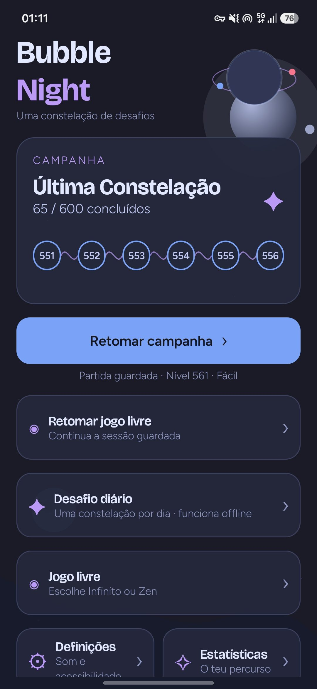<br><sub>Home</sub></td>
    <td align="center">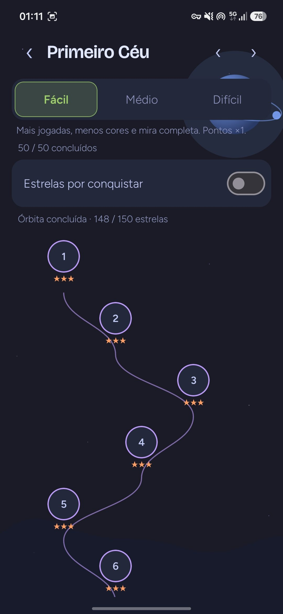<br><sub>Orbit map</sub></td>
    <td align="center">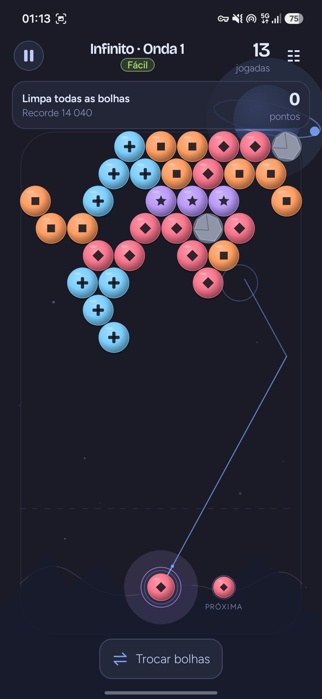<br><sub>Aim guide with bounce</sub></td>
    <td align="center">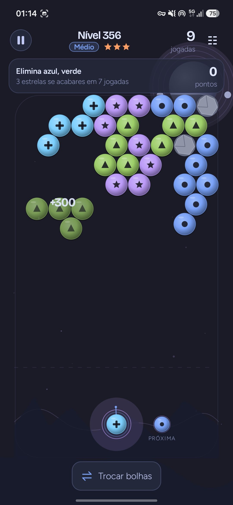<br><sub>Dropping a group</sub></td>
  </tr>
  <tr>
    <td align="center">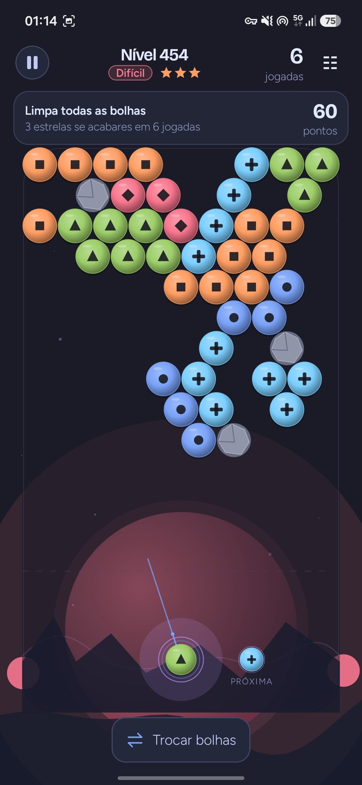<br><sub>Hard level with rocks</sub></td>
    <td align="center">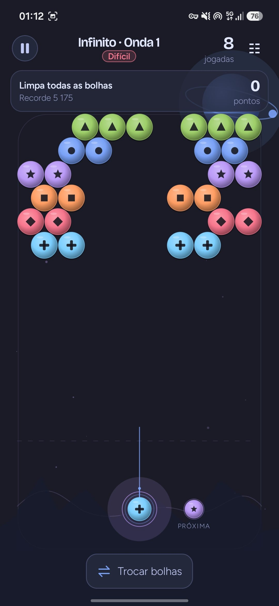<br><sub>Endless mode</sub></td>
    <td align="center">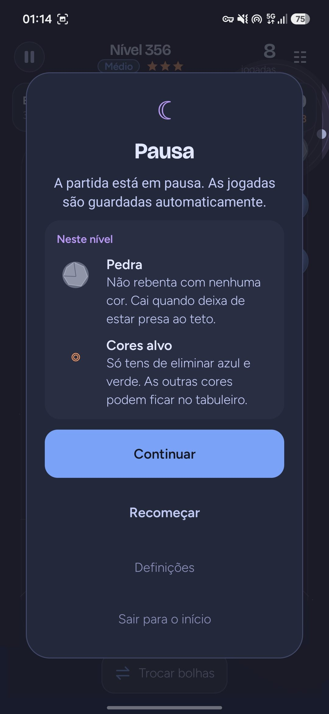<br><sub>Pause and piece tips</sub></td>
    <td align="center">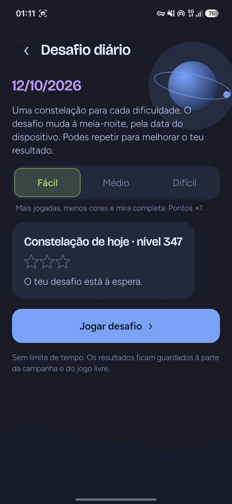<br><sub>Daily challenge</sub></td>
  </tr>
  <tr>
    <td align="center">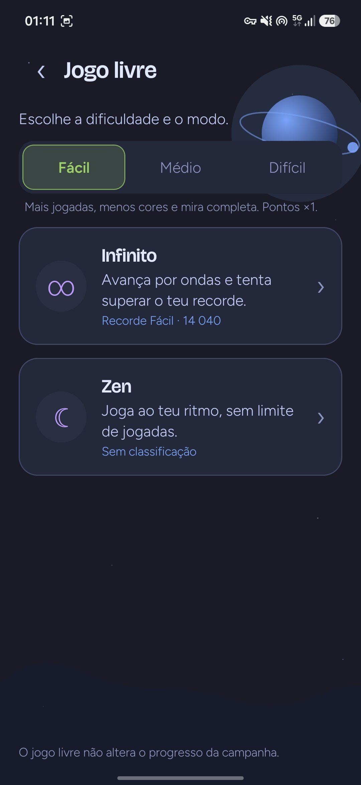<br><sub>Free play</sub></td>
    <td align="center">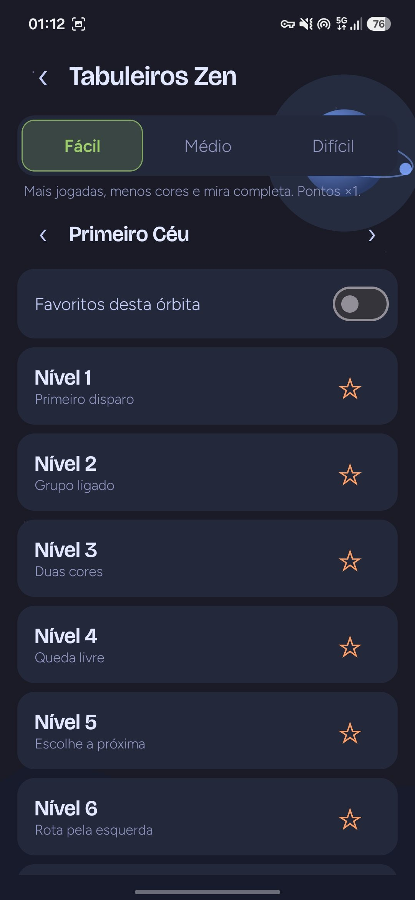<br><sub>Zen boards</sub></td>
    <td align="center">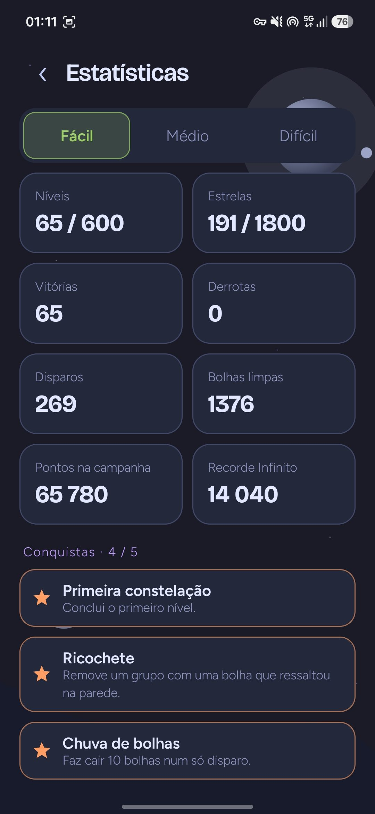<br><sub>Statistics</sub></td>
    <td align="center">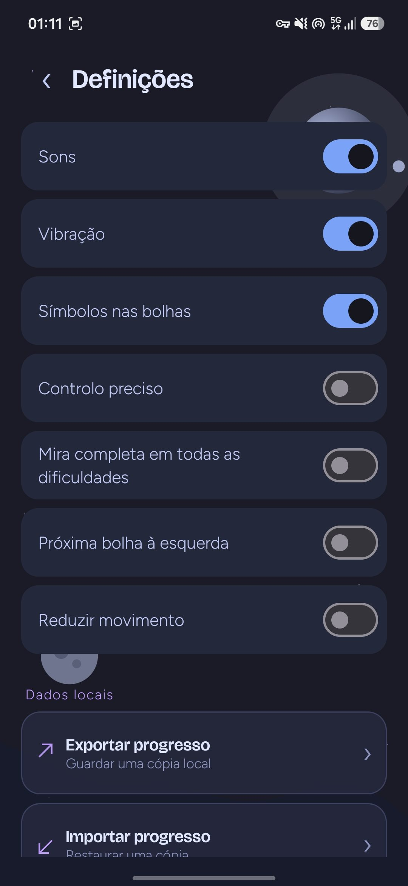<br><sub>Settings</sub></td>
  </tr>
</table>

## How to play

1. **Aim:** drag on the board to aim, then lift your finger to shoot. To cancel, drag off the board before lifting. With *Precise aim controls* on, use the arrow buttons and **Shoot** instead.
2. **Match:** a bubble sticks where it first touches. Three or more connected bubbles of the same color pop.
3. **Drop:** anything no longer connected to the ceiling falls. Big drops are worth the most.
4. **Swap:** swapping the current and next bubble is free and costs no shots.

| Piece | Behavior |
|---|---|
| Color bubble | Pops in groups of three or more. Each color also has a symbol (circle, star, triangle, square, diamond, cross). |
| Rock | Never pops. It falls once it loses its link to the ceiling. |
| Star | A captive star. Rescue it by making it fall. |

**Objectives.** A level asks you to clear every bubble, rescue every star, or clear a set of target colors.

**Stars.** You earn 1 star for finishing, 2 or 3 stars for finishing within the level's shot targets. The HUD always shows the best rating you can still reach.

**Scoring.** 10 points per popped bubble, 20 per falling bubble and 10 per falling rock, multiplied by `1 + fallen / 4`. Each rescued star is worth 100. Consecutive shots that remove something build a streak of up to ×4. Each unused shot is worth 50 when you win. Every part is then scaled by the difficulty.

## Building from source

### Requirements

| Tool | Version |
|---|---|
| JDK | 17 or newer (the project is built with JDK 21) |
| Android SDK | Platform `android-37.2`, build tools 37 |
| Gradle | Wrapper included (9.8.0) |
| Python 3 | Only for the optional authoring scripts in `tools/` |

No emulator is needed. The game logic is tested on the JVM.

### Build and install

```bash
git clone https://github.com/SyscallBrain/bubble-night.git
cd bubble-night

export JAVA_HOME=/path/to/jdk-21          # any JDK 17+
export ANDROID_HOME=/path/to/android-sdk  # or create local.properties with sdk.dir=...

./gradlew :app:assembleDebug
adb install app/build/outputs/apk/debug/app-debug.apk
```

`./gradlew :app:assembleRelease` builds an unsigned release APK. To sign it, define `bubbleNight.release.storeFile`, `storePassword`, `keyAlias` and `keyPassword` (all with the `bubbleNight.release.` prefix) in your own `~/.gradle/gradle.properties`. Never commit them.

The first build verifies the level catalog. It validates the 600 levels and replays all 1,800 certificates before packaging the assets, so it takes a few minutes. Later builds reuse the result until something in `content/` changes.

### Full verification

```bash
bash tools/verify.sh
```

This runs the unit tests of all three modules, strict catalog validation, certificate replay, Android lint and the debug APK build. It reports the real exit code of each step and writes the logs to `logs/`.

## Architecture

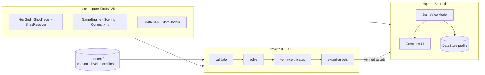

| Module | Role |
|---|---|
| [`core/`](core) | Deterministic game engine with no Android dependencies: hex grid geometry, analytic shot tracing with wall bounces, slot snapping, match and drop rules, scoring, a versioned SplitMix64 RNG and canonical state hashing. |
| [`leveltool/`](leveltool) | Content CLI that uses the same engine to validate, solve (beam search), certify, rebalance, generate procedural orbits, promote candidates and export the packaged assets. |
| [`app/`](app) | Jetpack Compose UI, `GameViewModel`, DataStore persistence with recovery copies, backup import and export, audio and haptics, and the crash log. |
| [`content/`](content) | Source catalog: 600 level files, 1,800 certificates, JSON schemas and authoring templates. |
| [`tools/`](tools) | Verification, orbit generation and asset authoring scripts. |
| [`fastlane/`](fastlane/metadata/android) | Store listing (texts, icon, screenshots) used by F-Droid. |

Some design choices:

- **One engine everywhere.** The solver, the certificate checker and the game all run the same `:core` code, so a certified solution is replayed exactly as the player would play it.
- **Turn-based, not frame-based.** A shot is resolved completely by a pure function. The UI only animates the immutable events it returns, so frame rate never affects collisions, score or randomness.
- **Verified assets.** The app checks every packaged level against the SHA-256 manifest written at build time.
- **Crash-safe progress.** The game state is saved after every move. Corrupt data is never silently reset; the previous valid copy is restored instead.

More detail: [docs/ARCHITECTURE.md](docs/ARCHITECTURE.md) and [docs/CONTENT.md](docs/CONTENT.md).

## Level content

Levels live in `content/` as plain JSON. Orbit 1 is hand-authored; orbits 2–12 are generated procedurally from structural families and kept only when the solver can prove a three-star route on every difficulty.

```bash
./gradlew :leveltool:run --args='validate --catalog content/catalog.json --strict'
./gradlew :leveltool:run --args='verify-certificates --catalog content/catalog.json'
./gradlew :leveltool:run --args='report --catalog content/catalog.json --output report.json'
```

See [docs/CONTENT.md](docs/CONTENT.md) for the level format, validation rules, the solver and the full generation pipeline.

## Privacy

Bubble Night declares a single permission, `VIBRATE`. It has no internet access, collects no data and contains no third-party SDKs. Progress is stored in the app's private storage. Exporting a backup or sharing a result happens only when you choose to, through the Android system picker. If the game crashes, the stack trace is saved locally, and you can export it from **Settings → Export diagnostics** to attach it to a bug report.

## Contributing

Bug reports, translations and pull requests are welcome. Please read [CONTRIBUTING.md](CONTRIBUTING.md) first. It covers the development setup, coding conventions and the rules for changing level content.

## Credits

- Design and development: **Tiago Correia**
- Fonts: [Figtree](https://github.com/erikdkennedy/figtree) and [Bricolage Grotesque](https://github.com/ateliertriay/bricolage), both under the SIL Open Font License (texts in [`app/src/main/assets/licenses`](app/src/main/assets/licenses)).
- Sound effects: original tones synthesized by [`tools/generate_sounds.py`](tools/generate_sounds.py).

## License

Released under the [MIT License](LICENSE). Copyright © 2026 Tiago Correia.
