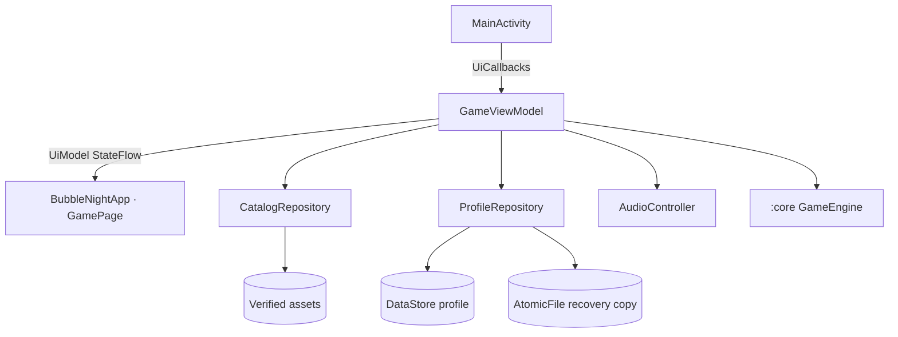

# Architecture

Bubble Night is a Gradle project with three modules. They share one game engine, so a level the solver certifies plays exactly the same way on a phone.

```
bubble-night/
├── core/        Pure Kotlin/JVM engine (no Android)
├── leveltool/   Content CLI built on :core
├── app/         Android app (Jetpack Compose) built on :core
├── content/     Source catalog, levels, certificates, schemas, templates
└── tools/       Verification and authoring scripts
```

## `:core`: the deterministic engine

The engine has no Android dependency and no clock, platform randomness or shared mutable state. Its output depends only on its input.

### Geometry

| Constant | Value |
|---|---|
| Logical board | 18 × 32 units, bubble radius `R = 1` |
| Launcher | `(9, 29)` |
| Danger line | `y = 24` |
| Grid | Staggered rows: even rows have 9 cells, odd rows 8. Center `x = 1 + 2c + (r mod 2)`, `y = 1 + √3·r` |
| Legal rows | `0..13`; row 13 is the overflow row |
| Aim | −75° to +75° from vertical, as an integer number of millidegrees |
| Tolerance | `1e-8` units |

- **`HexGrid`** precomputes neighbors and cell centers. Aiming queries them thousands of times per drag.
- **`ShotTracer`** traces the shot analytically. It finds the first contact against bubbles (combined radius 2), the ceiling and the side walls, and reflects off the walls (at most 8 bounces). Nothing depends on the frame rate.
- **`SnapResolver`** projects the continuous contact onto a legal empty cell on the arrival side of the bubbles it touched. If no cell qualifies, the shot is refused (`NoLegalSlot`) without spending a shot or advancing the RNG.

### Rules

`GameEngine` is a pure facade:

- `start(level, difficulty, mode, sessionId)` builds the initial `GameState` from a validated `LevelDefinition`.
- `preview(state, angle)` runs the same trace and snap as a real shot. The aim guide always shows what will actually happen.
- `shoot(state, angle)` resolves a whole turn: place the bubble, pop groups of three or more of the same color, drop everything no longer connected to the ceiling, update the objective, score, streak and stars, and refill the ammunition. It returns a new state plus immutable events (`Placed`, `Matched`, `Dropped`, `Rescued`, `Scored`, `Won`, `Lost`).
- `swap(state)` exchanges the current and next bubble. It is free and does not touch the RNG.

The terminal checks run in a fixed order: objective complete, then danger line, then no shots left, then no colors left to play.

### Randomness and hashing

- **`SplitMix64`** (version 1) draws the ammunition. Each variant has its own seed, and draws use rejection sampling to avoid modulo bias. The raw RNG state is stored as 16 hex digits.
- **`StateHasher`** writes the logical state (occupancy, queue, RNG, counters, objective, outcome) in a canonical, versioned form and hashes it with SHA-256. Session ids, timestamps and animation data are excluded, so a certificate replay produces the same hashes on any JVM.

## `:leveltool`: content pipeline

A command-line tool that uses `:core` directly. The main commands:

| Command | Purpose |
|---|---|
| `validate` | Structural and semantic validation of the catalog, levels and families. |
| `solve` | Beam search for a three-star solution per variant; writes certificates. |
| `verify-certificates` | Replays every certificate and checks every hash. |
| `rebalance` | Derives shot budgets from the certified solution length and rebuilds certificates. |
| `extend` / `regenerate` | Generate procedural orbits (2–12) as candidate packs. |
| `promote` | Copies checked candidates into the published catalog (dry run unless `--write`). |
| `report` | Content statistics as JSON. |
| `export-assets` | Writes the packaged assets (levels, catalog, SHA-256 manifest) for the app. |

The `:app` build depends on `:leveltool:exportGameAssets`, which in turn depends on `validateGameContent`. That task validates the catalog and replays every certificate (`verify-certificates`). A broken level therefore fails the build. See [CONTENT.md](CONTENT.md).

## `:app`: Android client

### Layers



- **`GameViewModel`** coordinates commands in order. It calls the engine, turns its events into animation steps and builds an immutable `UiModel` for the screen. It is the only place where game state changes.
- **The UI** (`BubbleNightApp`, `GamePage`) is a pure function of `UiModel`. It reports user intent through `UiCallbacks` and draws the board on a Compose `Canvas`, interpolating the before and after snapshots of each event. It never predicts game rules.
- **`CatalogRepository`** reads only packaged assets. It checks the catalog and every level file against the SHA-256 manifest generated at build time, and caches a small number of decoded boards.

### Persistence

- The whole player profile (settings, progress per difficulty, statistics, achievements and the active campaign, free-play and daily sessions) is a single versioned JSON document in a typed **DataStore**.
- A shot appears on screen at once, and its save is queued right after it (`PendingSaves`). Saves run in order and outlive the ViewModel. If a save fails, the game pauses and offers **Try saving**; it never discards the move silently.
- **`BackupManager`** keeps a separate recovery copy with `AtomicFile`. On start, `ProfileRecoveryPolicy` uses the primary file when it is valid, restores the copy with a notice when it is not, and keeps both corrupt files for inspection when neither is valid. Data is never reset silently.
- **Export and import** use the Storage Access Framework. A backup is canonical JSON with a SHA-256 checksum, at most 2 MiB. Before anything is replaced, imports are fully validated (`ProfileValidator`) and previewed, and the player must confirm.
- Schema changes go through explicit migrations (`ProfileMigrations`). A profile from an unknown future version is rejected, never read as empty.

### Game modes

| Mode | Source of levels |
|---|---|
| Campaign | Sequential unlock per difficulty. |
| Daily | `DailyChallenge` picks a level from the local date and difficulty with a coprime stride, so all 600 levels come up before any repeats. |
| Endless | `EndlessDeck` shuffles deterministic pools that grow harder with the wave number (levels 1–100, 101–200, 201–400, then 401–600). |
| Zen | Any level, no shot budget, no score. |

All modes play certified variants with their published ammunition seeds; a mode never changes the RNG.

### Localization

Every visible text is an Android resource. `values/` holds English (the default) and `values-pt/` holds Portuguese. Orbit names and the hand-authored titles of orbit 1 are string arrays; procedural levels are titled by position (*Orbit N · level M*). The `titlePt` field in the content files is authoring metadata only.

### Diagnostics

`CrashLog`, installed in `App.onCreate`, saves the stack trace of any uncaught exception to private storage, from where the player can export it in Settings. Debug builds also write a copy to `Download/crashlogs/`. Nothing is sent anywhere.

## Testing

| Module | Focus |
|---|---|
| `:core` | Geometry, snapping, match and drop rules, scoring, RNG vectors, state hashing, determinism. |
| `:leveltool` | Validation rules, procedural generation, budgets, tamper detection for certificates. |
| `:app` | Profile JSON, migrations, validation, recovery, reducer and scoring flow, endless deck, daily selection, pending saves, aim guide, packaged catalog decoding. |

All tests run on the JVM. `tools/verify.sh` runs them together with strict validation, certificate replay, lint and the APK build.
